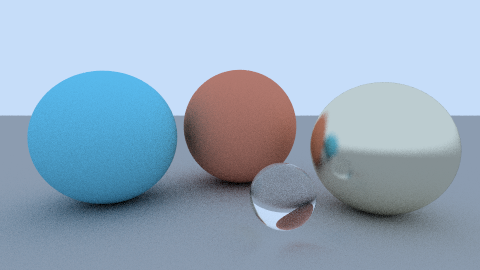
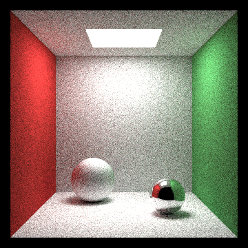
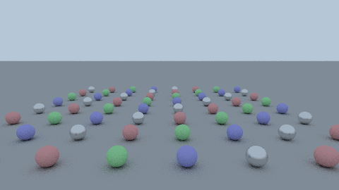

<p align="center">
  
</p>

<h1 align="center">MIND-Ray</h1>

<p align="center">
  A path tracer written in <a href="https://mindlang.dev">MIND</a>, with a separate CUDA kernel and benchmark suite for NVIDIA GPUs.
</p>

<p align="center">
  <a href="https://github.com/star-ga/mind-ray/actions/workflows/ci.yml"></a>
  <a href="LICENSE"></a>
  <a href="https://github.com/star-ga/mind/releases/tag/v0.10.2"></a>
</p>

---

## What it is

MIND-Ray has two independent parts:

| Part | Location | Language | What it does |
|------|----------|----------|--------------|
| **CPU renderer** | [`src/main.mind`](src/main.mind) | MIND | Unidirectional path tracer: spheres, ground planes and axis-aligned rectangles; diffuse, metal, glass and emissive materials; writes a binary PPM and an FNV-1a image hash. |
| **CUDA kernel** | [`native-cuda/`](native-cuda/) | CUDA C++ | BVH-accelerated GPU path tracer exposed as a C ABI shared library (`mindray_cuda_*`), driven by the benchmark host in [`bench/`](bench/). |

The CUDA kernel is hand-written CUDA C++. It is not compiled from MIND, and the
MIND renderer does not call it.

## Status

| Component | State | Verified by |
|-----------|-------|-------------|
| MIND renderer | Builds with the released `mindc` v0.10.2 and renders all three scenes | CI: `./scripts/test.sh` (type-check, build, exact image hashes) |
| CUDA kernels | Compile with CUDA 13.4 for `sm_75`, `sm_86`, `sm_89`, `sm_120` (+ PTX) | CI: `./native-cuda/build.sh` in `nvidia/cuda:13.4.2-devel-ubuntu24.04` |
| CUDA benchmark host | Windows only (`LoadLibrary`) | Manual; results recorded 2026-01-05 (see below) |
| Pre-0.10 modular MIND sources | Kept for reference, do not compile with current `mindc` | [`archive/mind-pre-0.10/`](archive/mind-pre-0.10/) |

## Renders

Rendered by the MIND renderer in this repository. Each image is reproducible
with the command under it; the hash is the FNV-1a 32-bit hash of the pixel
bytes that the renderer prints on stderr.

| Spheres | Cornell box | Stress (64 spheres) |
|---------|-------------|---------------------|
|  |  |  |
| `./scripts/run.sh spheres 480 270 64 6 42` | `./scripts/run.sh cornell 360 360 256 6 42` | `./scripts/run.sh stress 480 270 32 4 42` |
| `fnv1a32=b190b3bd` | `fnv1a32=6a1239f6` | `fnv1a32=842975cb` |

Convert a PPM to PNG with `python3 scripts/ppm_to_png.py out/<scene>.ppm out/<scene>.png`
(standard library only).

## Quick start

### MIND renderer (Linux / macOS)

`mindc build` lowers MIND through MLIR, so it needs `mlir-opt`, `mlir-translate`
and `clang` next to `mindc`.

```bash
git clone https://github.com/star-ga/mind-ray.git
cd mind-ray

# MLIR toolchain (Ubuntu 24.04; on macOS: brew install llvm and add it to PATH)
sudo apt install mlir-20-tools clang-20
export PATH=/usr/lib/llvm-20/bin:$PATH

./scripts/get_mindc.sh        # downloads mindc v0.10.2, verifies its SHA-256, installs ./toolchain/mindc
./scripts/check_toolchain.sh  # mindc, mlir-opt, mlir-translate, clang
./scripts/build.sh            # mindc check src/ && mindc build --release
./scripts/run.sh cornell 360 360 256 6 42
python3 scripts/ppm_to_png.py out/cornell.ppm out/cornell.png
./scripts/test.sh             # rebuilds and checks the recorded image hashes
```

The binary reads one line from stdin:

```bash
echo "<scene> <width> <height> <spp> <bounces> <seed>" | ./target/release/mind-ray > image.ppm
```

`scene` is `spheres`, `cornell` or `stress`; missing fields default to
`spheres 320 180 16 4 42`.

Windows: `scripts\*.ps1` mirror these scripts. They need the same MLIR tools on
`PATH`; if your LLVM distribution does not ship `mlir-opt`, use WSL and the
`.sh` scripts.

### CUDA kernel

```bash
# Linux: compile all three kernels to native-cuda/build/*.so (CUDA 12.8+)
./native-cuda/build.sh
```

```powershell
# Windows (Developer PowerShell for Visual Studio, CUDA 12.8+)
.\native-cuda\build_opt.ps1          # builds mindray_cuda.dll and copies it to bench\
cd bench; .\build_bench.bat          # builds cuda_benchmark.exe
.\cuda_benchmark.exe --scene stress --spheres 64 --width 640 --height 360 --spp 64
```

## How it uses MIND

The renderer is one MIND module written in the subset that the released
`mindc` v0.10.2 compiles to a native executable through MLIR:

- **f64 scalar math, i64 integers, `while` loops, `if`/`else`**: vectors are
  three `f64` locals; every operation is a plain add, subtract, multiply or
  divide in fixed source order.
- **Raw memory intrinsics** (`__mind_alloc`, `__mind_load_i64`,
  `__mind_store_i64`, `__mind_store_i8`): the scene table, the per-pixel RNG
  state and the image buffer.
- **`__mind_read` / `__mind_write`**: configuration from stdin, PPM to stdout,
  hash line to stderr.
- **`mindc check`**: format, lint and type-check gate before every build.

Square roots use a fixed-iteration Newton solve, RNG is xorshift32 on integers
and the scene is stored as integer thousandths. The source header explains
which language features this works around and what the upgrade path is (a
module split with a `Vec3` struct once released `mindc` lowers float-field
structs and f64 values across modules).

The recorded hashes in [`scripts/test.sh`](scripts/test.sh) were produced with
mindc v0.10.2 on x86-64 Linux, and the same hashes were obtained with both the
LLVM 18 and LLVM 20 MLIR toolchains.

## CUDA benchmark results (recorded)

The tables below were produced by the CUDA kernel in `native-cuda/` (labelled
*Mind-Ray* in the benchmark tables) on 2026-01-05 with an NVIDIA GeForce RTX
4070 Laptop GPU, Windows 11, driver 591.44 and CUDA 12.8. They were not re-run
for this release. Raw logs are in [`bench/results/`](bench/results/) and the
methodology is in [`BENCHMARK.md`](BENCHMARK.md) and
[`bench/contract_v2.md`](bench/contract_v2.md). Reproducing them needs the
same GPU class and the third-party engines listed below.

<!-- AUTO_BENCH_SUMMARY_START -->
**GPU**: NVIDIA GeForce RTX 4070 Laptop GPU | **Config**: 640x360, 64 SPP, 4 bounces

### Tier B Wall-Clock Leaderboard (GPU-Only)

**Winner: Mind-Ray** — fastest end-to-end wall clock across all scenes.

| Rank | Engine | Geomean (ms) | vs Mind-Ray |
|------|--------|--------------|-------------|
| 1 | **Mind-Ray** | **99.8** | baseline |
| 2 | Mitsuba 3 | 1046.8 | 10.5x slower |
| 3 | Falcor | 1202.4 | 12.0x slower |
| 4 | Cycles 5.0 | 2992.7 | 30.0x slower |
| 5 | LuxCore | 5041.1 | 50.5x slower |

*Lower is better. Geomean across stress_n64, stress_n128, stress_n256.*

### Tier BP: Persistent Mode (Mind-Ray vs Mitsuba 3)

| Metric | Mind-Ray | Mitsuba 3 | Speedup |
|--------|----------|-----------|---------|
| Steady-State (ms/frame) | 5.6 | 131.6 | **48.4x** |
| Cold Start (ms) | 71.6 | 480.8 | **6.7x** |

### Tier A Kernel Leaderboard

| Rank | Engine | Geomean (M rays/s) | vs Mind-Ray |
|------|--------|-------------------|-------------|
| 1 | **Mind-Ray** | **3517** | baseline |
| 2 | OptiX SDK | 857 | 4.1x slower |
| 3 | CUDA Reference | 329 | 10.7x slower |

*Higher is better. Kernel-only timing via CUDA events.*

See [`BENCHMARK.md`](BENCHMARK.md) for methodology and [`docs/PITCH_ONE_SLIDE.md`](docs/PITCH_ONE_SLIDE.md) for full breakdown.
<!-- AUTO_BENCH_SUMMARY_END -->

| Tier | Measures | Comparison |
|------|----------|------------|
| **A** | Kernel-only (CUDA events) | CUDA kernel vs CUDA Reference, OptiX SDK |
| **B** | Process wall clock | CUDA kernel vs GPU renderers |
| **BP** | Persistent (cold + steady) | CUDA kernel vs Mitsuba 3 (GPU) |

Numbers are never compared across tiers. Latest reports:
[Tier A](bench/results/LATEST.md),
[Tier B](bench/results/LATEST_TIER_B.md),
[Tier BP](bench/results/LATEST_TIER_BP.md).

### Registered engines

<!-- AUTO_ENGINE_MATRIX_START -->
| Engine | Tier | Device | Status | Source |
|--------|------|--------|--------|--------|
| Mind-Ray CUDA | A | GPU | Ready | [This repo](https://github.com/star-ga/mind-ray) |
| Mind-Ray Tier B | B | GPU | Ready | [This repo](https://github.com/star-ga/mind-ray) |
| Mind-Ray Tier BP | BP | GPU | Ready | [This repo](https://github.com/star-ga/mind-ray) |
| Mitsuba 3 | B, BP | GPU | Ready | [Link](https://github.com/mitsuba-renderer/mitsuba3) |
| Blender Cycles | B | GPU | Ready | [Link](https://www.blender.org/download/) |
| NVIDIA Falcor | B | GPU | Ready | [Link](https://github.com/NVIDIAGameWorks/Falcor) |
| LuxCoreRender | B | GPU | Ready | [Link](https://luxcorerender.org/download/) |
| OptiX SDK | A | GPU | Ready | [Link](https://developer.nvidia.com/optix) |
| CUDA Reference | A | GPU | Ready | [Link](https://developer.nvidia.com/cuda-toolkit) |
| PBRT-v4 | B | GPU | Blocked | [Link](https://github.com/mmp/pbrt-v4) |

**GPU-Only Policy**: Tier B and BP include only GPU-accelerated engines. Blocked/pending engines excluded from leaderboards.

*Source: `bench/engines.json` (v2.1)*
<!-- AUTO_ENGINE_MATRIX_END -->

## Repository layout

```
mind-ray/
├── Mind.toml                 # MIND package manifest (entry: src/main.mind)
├── src/main.mind             # MIND CPU renderer
├── scripts/                  # get_mindc, check_toolchain, build, run, test (.sh and .ps1)
├── native-cuda/              # CUDA kernels + build scripts
├── bench/                    # CUDA benchmark host, engine adapters, recorded results
├── archive/mind-pre-0.10/    # earlier modular MIND sources (reference only)
├── archive/cuda_reference/   # CUDA reference renderer used in Tier A
├── docs/                     # architecture, toolchain, benchmark notes, renders
└── .github/workflows/ci.yml  # MIND build + hash check, CUDA compile check
```

## License

MIT, see [LICENSE](LICENSE).

## Links

- MIND language: [mindlang.dev](https://mindlang.dev)
- MIND compiler: [github.com/star-ga/mind](https://github.com/star-ga/mind)
- References: *Ray Tracing in One Weekend* (Peter Shirley); *Physically Based Rendering* (Pharr, Jakob, Humphreys)
